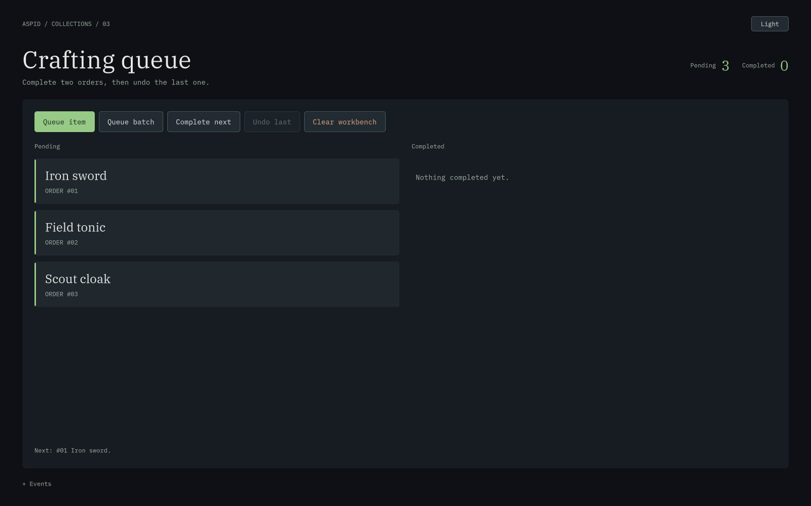

# Crafting Queue — очередь крафта и отмена



[Светлая тема](Preview-light.png)

Готовая сцена `Scenes/CraftingQueue.unity` объединяет очередь ожидающих заказов и стек завершённых. Импортируйте **03 Crafting Queue** и запустите Play Mode. Нужен встроенный модуль UI Toolkit (`com.unity.modules.uielements`).

**Light / Dark** переключает тему. **+ Events** раскрывает журнал и дополнительные счётчики.

## Попробуйте

1. В очереди уже находятся заказы `#01`, `#02`, `#03`. **Complete next** завершит `#01`, затем `#02`.
2. Слева останется `#03`. Справа стек покажет `#02` над `#01`: последний завершённый заказ отменяется первым.
3. Нажмите **Undo last**. Заказ `#02` исчезнет из истории и вернётся в конец очереди после `#03`.
4. **Queue batch** добавит три заказа одним `EnqueueRange`; журнал покажет пакетную операцию.
5. **Clear workbench** очистит обе коллекции и удалит их представления. Кнопки завершения и отмены станут недоступны; **Queue item** снова создаст работу.

## Данные и представления

```csharp
_pendingTickets = _pending.CreateSync(
    CreateTicket, ticket => ticket.RemoveFromHierarchy());
_historyTickets = _history.CreateSync(
    CreateTicket, ticket => ticket.RemoveFromHierarchy());

if (_pending.TryDequeue(out var order))
    _history.Push(order);

if (_history.TryPop(out var completed))
    _pending.Enqueue(completed);
```

В `Scripts/CraftingQueueSample.cs` предметный `WorkOrder` переносится между коллекциями, а его UI в каждой проекции создаётся независимо. Удаление заказа из очереди освобождает её билет; стек создаёт свой билет. Обычный `VisualElement` не реализует `IDisposable`, поэтому здесь показана перегрузка `CreateSync` с обработчиком удаления.

Отмена означает повторную постановку на обработку в конец очереди. Она не восстанавливает прежнюю позицию и не моделирует возврат потраченных ресурсов. Для настоящей системы крафта добавьте предметную команду с соответствующими правилами.

## Владение

Компонент снимает свои обработчики и освобождает обе проекции до исходных очереди и стека. Обработка событий обновляет UI; покадрового опроса коллекций нет. Лимит в 12 заказов учитывает ожидающие и завершённые вместе и нужен для удобства демонстрации.
