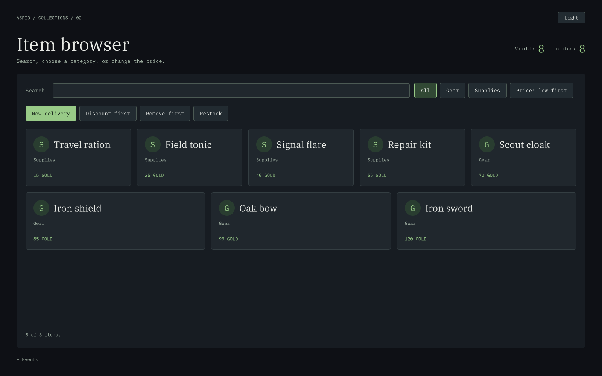

# Item Browser — каталог предметов



[Светлая тема](Preview-light.png)

Готовая сцена `Scenes/ItemBrowser.unity` показывает поиск, категории и сортировку одного источника данных. Импортируйте **02 Item Browser** и запустите Play Mode. Нужен встроенный модуль UI Toolkit (`com.unity.modules.uielements`).

**Light / Dark** переключает тему. **+ Events** раскрывает журнал и дополнительные счётчики.

## Попробуйте

1. В начале отображаются 8 предметов по возрастанию цены.
2. Введите `iron` в поле поиска. Останутся **Iron shield** за 85 и **Iron sword** за 120.
3. Выберите **Supplies**. Появится пустое состояние; счётчик `In stock` останется равным 8. Верните **Gear**.
4. Нажмите **Discount first** дважды. Цена первого элемента источника, **Iron sword**, снизится до 70; меч переместится перед щитом. `Update()` вызывается явно после изменения свойства `Price`.
5. Нажмите **Price: low first**, чтобы изменить порядок. **New delivery** добавит предмет, который сразу пройдёт действующие фильтры.
6. **Remove first** удаляет первый элемент исходного каталога, а не первый видимый результат. **Restock** восстанавливает 8 исходных предметов, сохраняя поиск, категорию и порядок сортировки.

## Цепочка представлений

```csharp
_search = _stock.CreateFiltered(MatchesSearch);
_visible = _search.CreateFiltered(MatchesCategory, PriceComparer());

_stock.Add(item); // Both views follow the collection event.

item.Price -= 25; // No collection event is emitted by a property edit.
_search.Update(); // Refresh upstream so the entire chain updates.
```

В `Scripts/ItemBrowserSample.cs` предикаты читают текущий запрос и категорию. После изменения захваченного значения вызывается `Update()` соответствующего представления. Присваивание нового `Comparer` само обновляет отсортированное представление. При одинаковой цене порядок определяется именем; исходный список не сортируется.

`FilteredList.CollectionChanged` — сигнал об изменении всего представления без аргументов с индексами. Поэтому этот пример пересоздаёт карточки после такого сигнала. Он не обещает сохранения карточек при фильтрации; сохранение идентичности `CreateSync` отдельно показано в Squad Roster.

## Владение и потоки

`OnDisable` освобождает `_visible`, затем `_search`, затем `_stock`. Такой порядок снимает подписки цепочки от последнего потребителя к источнику. Чтение, поиск и изменение каталога выполняются на одном потоке. Для данных из фоновой загрузки сначала передайте изменение на главный поток.
