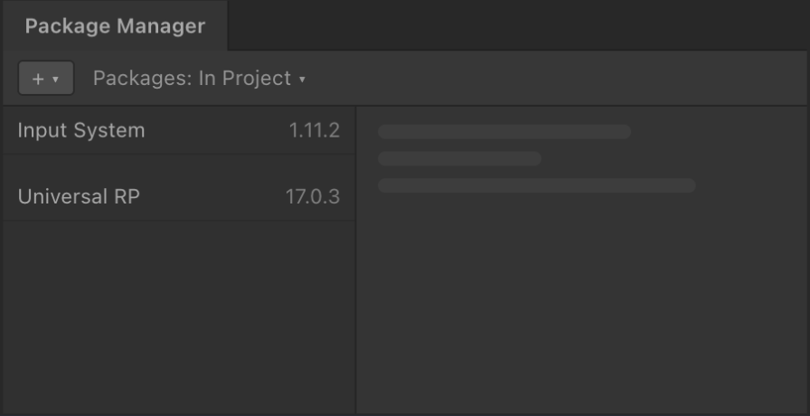

<picture>
  <source srcset="Documentation/Images/aspid_collections_readme_banner_dark.webp" />
  
</picture>

[](#installation)
[](https://github.com/VPDPersonal/Aspid.Collections/releases/latest)
[](LICENSE)

Aspid.Collections provides observable collections for Unity and .NET. React to changes in an inventory or leaderboard, project models into view models, and keep filtered and sorted views up to date. The runtime is pure C# and has no Unity engine dependency.

**English** · [Русский](README_RU.md)

## Installation

<table>
<tr>
<td width="56%"></td>
<td width="44%">
<ol>
<li>Open <b>Window → Package Manager</b></li>
<li>Choose <b>+ → Install package from git URL…</b></li>
<li>Paste the URL and press <b>Install</b></li>
</ol>
</td>
</tr>
</table>

```text
https://github.com/VPDPersonal/Aspid.Collections.git#upm
```

The URL installs the latest release. **Update** in the Package Manager installs the next one. To pin a version or switch channels, see [Installation options](#installation-options).

Requires Unity 2021.3.0f1 or newer.

<details>
<summary>Troubleshooting</summary>

**Compile errors right after the install.** Check your Unity version in **Help → About Unity** (**Unity → About Unity** on macOS).

**The Console shows `Assembly with name 'Aspid.Collections.Observable' already exists`.** The project has a second copy of the package, for example its folder under `Assets`. Delete the copy.

**Package Manager cannot resolve `com.unity.test-framework@1.6.0`.** If you pinned `#upm/1.1.0`, switch to `#upm/1.1.1` or update to the latest version on `#upm`. Version 1.1.1 removes this dependency. [PR #20](https://github.com/VPDPersonal/Aspid.Collections/pull/20)

</details>

## Features

<table>
<tbody>
<tr><th colspan="2" align="left"><h3>Change notifications</h3></th></tr>
<tr>
<td width="60%" valign="top">

```csharp
using var items =
    new ObservableList<string>();
items.CollectionChanged += change =>
    Console.WriteLine(change.Action);

items.Add("Potion");       // Add
items[0] = "Elixir";       // Replace
items.RemoveAt(0);         // Remove
```

</td>
<td width="40%" valign="top">

`CollectionChanged` reports each edit. Use `IsSingleItem` to choose between the single-item and batch fields. Disposing the list emits `Reset`.

[Basic Change Notifications →](Aspid.Collections/Packages/tech.aspid.collections/Samples~/01_BasicChangeNotifications)

</td>
</tr>
</tbody>
<tbody>
<tr><th colspan="2" align="left"><h3>Synchronized views</h3></th></tr>
<tr>
<td valign="top">

```csharp
using var scores = new ObservableList<int>();
using var labels = scores.CreateSync(
    n => $"Score {n}");

scores.Add(10);
scores[0] = 20;
Console.WriteLine(labels[0]); // Score 20
```

</td>
<td valign="top">

`CreateSync` builds a read-only projection that follows the source. All five collection types support it. [Overloads](Aspid.Collections/Packages/tech.aspid.collections/Runtime/Observable/Synchronizer/Extensions/CreateSyncExtensions.cs)

[Inventory Sync →](Aspid.Collections/Packages/tech.aspid.collections/Samples~/02_InventorySync)

</td>
</tr>
</tbody>
<tbody>
<tr><th colspan="2" align="left"><h3>Filtering and sorting</h3></th></tr>
<tr>
<td valign="top">

```csharp
using var scores =
    new ObservableList<int> { 25, 5, 15 };
using var visible = scores.CreateFiltered(
    n => n >= 10, Comparer<int>.Default);

scores.Add(12);
Console.WriteLine(
    string.Join(", ", visible)); // 12, 15, 25
```

</td>
<td valign="top">

`CreateFiltered` filters and sorts a view of the source. Change `Filter` or `Comparer` at runtime. Call `Update()` after editing a source without notifications.

[Filtered Inventory →](Aspid.Collections/Packages/tech.aspid.collections/Samples~/03_FilteredInventory)

</td>
</tr>
</tbody>
<tbody>
<tr><th colspan="2" align="left"><h3>Separate callbacks for each change</h3></th></tr>
<tr>
<td valign="top">

```csharp
using var items =
    new ObservableList<string>();
using var events = items.SplitByEvents(
    added: (batch, _) =>
        Console.WriteLine(
            $"Added {batch.Count}"));

items.AddRange("Potion", "Elixir"); // Added 2
```

</td>
<td valign="top">

`SplitByEvents` gives each change type its own handler. Item handlers always receive a list.

[Analytics Tap →](Aspid.Collections/Packages/tech.aspid.collections/Samples~/05_SplitByEvents)

</td>
</tr>
</tbody>
</table>

## Collections

<table>
<thead>
<tr><th width="420">Type</th><th width="700">Use it for</th></tr>
</thead>
<tbody>
<tr><td><a href="Aspid.Collections/Packages/tech.aspid.collections/Runtime/Observable/ObservableList.cs"><code>ObservableList&lt;T&gt;</code></a></td><td>Ordered items with indexes, moves and range operations</td></tr>
<tr><td><a href="Aspid.Collections/Packages/tech.aspid.collections/Runtime/Observable/ObservableDictionary.cs"><code>ObservableDictionary&lt;TKey, TValue&gt;</code></a></td><td>Items addressed by key, as in the <a href="Aspid.Collections/Packages/tech.aspid.collections/Samples~/04_DictionaryKeyedTable">keyed leaderboard sample</a></td></tr>
<tr><td><a href="Aspid.Collections/Packages/tech.aspid.collections/Runtime/Observable/ObservableHashSet.cs"><code>ObservableHashSet&lt;T&gt;</code></a></td><td>Unique items and membership checks</td></tr>
<tr><td><a href="Aspid.Collections/Packages/tech.aspid.collections/Runtime/Observable/ObservableQueue.cs"><code>ObservableQueue&lt;T&gt;</code></a></td><td>First-in, first-out processing with range operations</td></tr>
<tr><td><a href="Aspid.Collections/Packages/tech.aspid.collections/Runtime/Observable/ObservableStack.cs"><code>ObservableStack&lt;T&gt;</code></a></td><td>Last-in, first-out processing with range operations</td></tr>
</tbody>
</table>

## Development

Open `Aspid.Collections/` from a clone of the source repository in Unity 6000.6.5f1. Unity loads the embedded package from `Packages/tech.aspid.collections/`. Run the tests in the Test Runner's **PlayMode** tab or use `dotnet test DotnetTests/Aspid.Collections.Tests.csproj` from the repository root to run the unit tests outside Unity. [Source repository](https://github.com/VPDPersonal/Aspid.Collections)

## Resources

| [Unity samples](Aspid.Collections/Packages/tech.aspid.collections/Samples~) | [Runtime API](Aspid.Collections/Packages/tech.aspid.collections/Runtime/Observable) | [Changelog](CHANGELOG.md) |
| --- | --- | --- |
| In Package Manager, select **Aspid.Collections → Samples → Import**. Open the imported scene and enter Play mode. | Browse collection types, event arguments and extension methods. | See changes and fixes by release. |

### Installation options

To pin a version, use its `upm/<version>` tag, for example `#upm/1.1.1`. See the [available releases](https://github.com/VPDPersonal/Aspid.Collections/releases).

Preview releases use the `upm-preview` branch when available.

## Help and support

<p>Found a bug or have a question? Include your Unity version, package version and steps to reproduce.</p>
<p><a href="https://github.com/VPDPersonal/Aspid.Collections/issues"><b>Open an issue</b></a> · <a href="https://github.com/VPDPersonal/Aspid.Collections">Star on GitHub</a></p>
