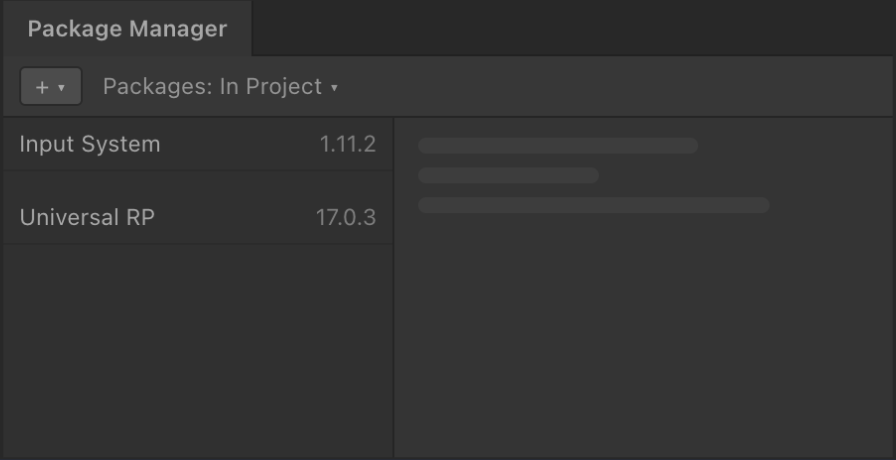

<picture>
  <source srcset="Documentation/Images/aspid_collections_readme_banner_dark.webp" />
  
</picture>

[](#установка)
[](https://github.com/VPDPersonal/Aspid.Collections/releases/tag/v1.1.1)
[](LICENSE)

Aspid.Collections — наблюдаемые коллекции для Unity и .NET. Реагируйте на изменения инвентаря или таблицы лидеров, преобразуйте модели в модели представления и обновляйте отфильтрованные и отсортированные списки вслед за источником. Библиотека написана на C# и работает без зависимостей от движка Unity.

[English](README.md) · **Русский**

## Установка

<table>
<tr>
<td width="56%"></td>
<td width="44%">
<ol>
<li>Откройте <b>Window → Package Manager</b></li>
<li>Выберите <b>+ → Install package from git URL…</b></li>
<li>Вставьте URL и нажмите <b>Install</b></li>
</ol>
</td>
</tr>
</table>

```text
https://github.com/VPDPersonal/Aspid.Collections.git#upm
```

URL указывает на последнюю версию. Кнопка **Update** в Package Manager установит следующую. Чтобы закрепить версию или сменить канал, см. [варианты установки](#варианты-установки).

Нужна Unity 2021.3.0f1 или новее.

<details>
<summary>Решение проблем</summary>

**Сразу после установки появляются ошибки компиляции.** Проверьте версию Unity в **Help → About Unity** (**Unity → About Unity** на macOS).

**В Console появляется `Assembly with name 'Aspid.Collections.Observable' already exists`.** В проекте есть вторая копия пакета, например его папка в `Assets`. Удалите копию.

**Package Manager не может разрешить `com.unity.test-framework@1.6.0`.** Если вы закрепили `#upm/1.1.0`, переключитесь на `#upm/1.1.1` или обновитесь до актуальной версии в `#upm`. В 1.1.1 эту зависимость убрали. [PR #20](https://github.com/VPDPersonal/Aspid.Collections/pull/20)

</details>

## Возможности

<table>
<tbody>
<tr><th colspan="2" align="left"><h3>Уведомления об изменениях</h3></th></tr>
<tr>
<td width="60%" valign="top">

```csharp
using var items =
    new ObservableList<string>();
items.CollectionChanged += change =>
    Console.WriteLine(change.Action);

items.Add("Potion");       // Add
items[0] = "Elixir";       // Replace
items.RemoveAt(0);         // Remove
```

</td>
<td width="40%" valign="top">

`CollectionChanged` сообщает об изменениях. `IsSingleItem` помогает выбрать поля для одиночной или пакетной операции. При освобождении список отправляет `Reset`.

[Пример с уведомлениями →](Aspid.Collections/Packages/tech.aspid.collections/Samples~/01_BasicChangeNotifications)

</td>
</tr>
</tbody>
<tbody>
<tr><th colspan="2" align="left"><h3>Синхронизированные представления</h3></th></tr>
<tr>
<td valign="top">

```csharp
using var scores = new ObservableList<int>();
using var labels = scores.CreateSync(
    n => $"Score {n}");

scores.Add(10);
scores[0] = 20;
Console.WriteLine(labels[0]); // Score 20
```

</td>
<td valign="top">

`CreateSync` создаёт представление для чтения, которое обновляется вслед за источником. Поддерживаются все пять типов коллекций. [Перегрузки](Aspid.Collections/Packages/tech.aspid.collections/Runtime/Observable/Synchronizer/Extensions/CreateSyncExtensions.cs)

[Пример синхронизации инвентаря →](Aspid.Collections/Packages/tech.aspid.collections/Samples~/02_InventorySync)

</td>
</tr>
</tbody>
<tbody>
<tr><th colspan="2" align="left"><h3>Фильтрация и сортировка</h3></th></tr>
<tr>
<td valign="top">

```csharp
using var scores =
    new ObservableList<int> { 25, 5, 15 };
using var visible = scores.CreateFiltered(
    n => n >= 10, Comparer<int>.Default);

scores.Add(12);
Console.WriteLine(
    string.Join(", ", visible)); // 12, 15, 25
```

</td>
<td valign="top">

`CreateFiltered` фильтрует и сортирует представление источника. Меняйте `Filter` или `Comparer` во время работы. Если источник не отправляет уведомления, после изменения вызовите `Update()`.

[Пример фильтрации инвентаря →](Aspid.Collections/Packages/tech.aspid.collections/Samples~/03_FilteredInventory)

</td>
</tr>
</tbody>
<tbody>
<tr><th colspan="2" align="left"><h3>Отдельные обработчики изменений</h3></th></tr>
<tr>
<td valign="top">

```csharp
using var items =
    new ObservableList<string>();
using var events = items.SplitByEvents(
    added: (batch, _) =>
        Console.WriteLine(
            $"Added {batch.Count}"));

items.AddRange("Potion", "Elixir"); // Added 2
```

</td>
<td valign="top">

`SplitByEvents` вызывает отдельный обработчик для каждого типа изменения. Обработчики изменений элементов всегда получают список.

[Пример подписки для аналитики →](Aspid.Collections/Packages/tech.aspid.collections/Samples~/05_SplitByEvents)

</td>
</tr>
</tbody>
</table>

## Коллекции

<table>
<thead>
<tr><th width="420">Тип</th><th width="700">Для чего подходит</th></tr>
</thead>
<tbody>
<tr><td><a href="Aspid.Collections/Packages/tech.aspid.collections/Runtime/Observable/ObservableList.cs"><code>ObservableList&lt;T&gt;</code></a></td><td>Упорядоченный список с индексами, перемещением и пакетными операциями</td></tr>
<tr><td><a href="Aspid.Collections/Packages/tech.aspid.collections/Runtime/Observable/ObservableDictionary.cs"><code>ObservableDictionary&lt;TKey, TValue&gt;</code></a></td><td>Доступ по ключу, как в <a href="Aspid.Collections/Packages/tech.aspid.collections/Samples~/04_DictionaryKeyedTable">примере с таблицей лидеров</a></td></tr>
<tr><td><a href="Aspid.Collections/Packages/tech.aspid.collections/Runtime/Observable/ObservableHashSet.cs"><code>ObservableHashSet&lt;T&gt;</code></a></td><td>Уникальные элементы и проверка принадлежности множеству</td></tr>
<tr><td><a href="Aspid.Collections/Packages/tech.aspid.collections/Runtime/Observable/ObservableQueue.cs"><code>ObservableQueue&lt;T&gt;</code></a></td><td>Обработка в порядке добавления с пакетными операциями</td></tr>
<tr><td><a href="Aspid.Collections/Packages/tech.aspid.collections/Runtime/Observable/ObservableStack.cs"><code>ObservableStack&lt;T&gt;</code></a></td><td>Обработка в обратном порядке добавления с пакетными операциями</td></tr>
</tbody>
</table>

## Разработка

Откройте папку `Aspid.Collections/` из клона репозитория в Unity 6000.6.5f1. Unity загрузит встроенный пакет из `Packages/tech.aspid.collections/`. Запустите тесты на вкладке **PlayMode** в Test Runner. Для запуска модульных тестов вне Unity выполните `dotnet test DotnetTests/Aspid.Collections.Tests.csproj` из корня репозитория. [Исходный репозиторий](https://github.com/VPDPersonal/Aspid.Collections)

## Ресурсы

| [Примеры Unity](Aspid.Collections/Packages/tech.aspid.collections/Samples~) | [API библиотеки](Aspid.Collections/Packages/tech.aspid.collections/Runtime/Observable) | [История изменений](CHANGELOG.md) |
| --- | --- | --- |
| В Package Manager выберите **Aspid.Collections → Samples → Import**. Откройте импортированную сцену и запустите Play Mode. | Типы коллекций, аргументы событий и методы расширения. | Изменения и исправления по релизам. |

### Варианты установки

Чтобы закрепить версию, укажите её тег `upm/<версия>`, например `#upm/1.1.1`. См. [список релизов](https://github.com/VPDPersonal/Aspid.Collections/releases).

Предварительные релизы публикуются в ветку `upm-preview`.

## Помощь и поддержка

<p>Нашли ошибку или хотите задать вопрос? Укажите версию Unity, версию пакета и шаги воспроизведения.</p>
<p><a href="https://github.com/VPDPersonal/Aspid.Collections/issues"><b>Открыть задачу</b></a> · <a href="https://github.com/VPDPersonal/Aspid.Collections">Поставить звезду на GitHub</a></p>
